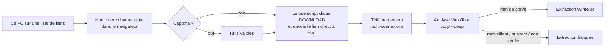

<div align="center">


# Haul

**Gestionnaire de téléchargements pour FuckingFast, sur Windows.**<br>
Copie les liens, Haul s'occupe du reste : téléchargement multi-connexions, analyse VirusTotal, extraction WinRAR.


</div>

---

## Fonctionnalités

- **Presse-papier surveillé** — sélectionne une liste de liens sur une page web et fais Ctrl+C :
  les URL sont lues dans la version HTML du presse-papier, même si le texte copié ne montre que
  les noms de fichiers.
- **Captcha respecté** — chaque page s'ouvre dans ton navigateur habituel, où tu valides le
  captcha si Cloudflare en demande un. Une validation vaut pour les liens suivants.
- **Téléchargement hors navigateur** — un userscript récupère le lien direct et l'envoie à Haul,
  qui télécharge en **plusieurs connexions par fichier**, plusieurs fichiers en parallèle,
  avec **reprise** après coupure.
- **Analyse VirusTotal avant extraction** — via [vtzip](docs/vtzip.md) (inclus) : hash des
  fichiers et des exécutables *à l'intérieur* des archives, sans rien extraire ni envoyer.
- **Extraction automatique** — chaque jeu dès que tous ses volumes sont téléchargés, si l'analyse
  ne signale rien. Chaque archive est d'abord vérifiée, rien d'existant n'est écrasé (voir
  [Sécurité](#sécurité)) ; les archives peuvent ensuite partir à la corbeille.
- **Un dossier par jeu** — `Elden_Ring_--_fitgirl-repacks.site_--_.part01.rar` va dans
  `Elden Ring\`, avec les fichiers bonus copiés en même temps.
- **Pause, reprise, liste conservée** — pause par fichier, « passer » une page qui attend un
  captcha ; la liste est retrouvée au lancement suivant, les téléchargements interrompus en pause.
  Une coupure réseau est retentée toute seule, un lien direct expiré rouvre sa page.
- **Notifications Windows** — quand un captcha attend dans le navigateur, quand la liste est
  finie ; progression affichée sur le bouton de la barre des tâches ; icône dans la zone de
  notification et démarrage avec Windows au choix.

## Comment ça marche



Le userscript communique avec Haul par un petit serveur HTTP local (`127.0.0.1:17655`), protégé
par un jeton secret propre à ton installation (voir [Sécurité](#sécurité)).

## Installation

### Prérequis

- Windows 10/11, [WinRAR](https://www.win-rar.com/) (pour l'extraction et le listage des RAR)
- Un navigateur avec [Violentmonkey](https://violentmonkey.github.io/) ou Tampermonkey
- Une clé API VirusTotal gratuite (profil > *API key* sur [virustotal.com](https://www.virustotal.com))
- Python 3.10+ seulement pour lancer depuis les sources ou construire l'exécutable

### Installation (recommandé)

Télécharge **[Haul.exe](https://github.com/Maxime272003/haul/releases/latest/download/Haul.exe)**
(dernière release) et place-le où tu veux, par exemple dans un dossier `Haul` de tes documents :
aucun Python requis. Haul se met ensuite à jour tout seul : il cherche une nouvelle version au
lancement puis toutes les 6 h, la télécharge en arrière-plan (empreinte SHA-256 vérifiée) et
l'installe quand tu le quittes, ou tout de suite avec **Redémarrer pour mettre à jour**. Réglage
*Mises à jour automatiques* pour désactiver. Place l'exécutable dans un dossier où tu peux écrire
(pas `C:\Program Files`), sinon il ne pourra pas se remplacer.

### Depuis les sources

```powershell
git clone <url-du-depot> haul
cd haul
py -3.12 -m venv .venv
.venv\Scripts\python -m pip install -e ".[dev]"
.venv\Scripts\haul                     # lance l'application
```

### Exécutable autonome

```powershell
.\scripts\build.ps1                    # produit dist\Haul.exe (aucun Python requis pour l'utiliser)
```

Lancé depuis les sources, Haul signale seulement qu'une nouvelle version est disponible.

### Première utilisation

1. Lance Haul, puis clique **Installer le script navigateur** : Violentmonkey propose
   d'installer le userscript. Il se synchronise ensuite tout seul avec Haul (jeton lu au moment
   de l'utiliser, mises à jour automatiques) : pas besoin de le réinstaller. Seule exception, une
   copie antérieure à la version 3.2 : Haul le signale, réinstalle-la une dernière fois.
2. Clique **Clé VirusTotal…**, colle ta clé API, *Tester* puis *Enregistrer*.
3. Copie une liste de liens `fuckingfast.co` depuis une page web : les téléchargements démarrent.

## Utilisation

| Réglage | Effet |
| --- | --- |
| Surveiller le presse-papier | Ajoute automatiquement les liens copiés. |
| Fichiers simultanés | Nombre de fichiers téléchargés en même temps (2–3 conseillés). |
| Connexions par fichier | Découpage de chaque fichier (8 conseillé). |
| Débit max | Plafond du débit total, de 1 à 100 Mo/s, ou illimité ; appliqué en une seconde, même en cours de fichier. |
| Un dossier par jeu | Range chaque jeu dans un sous-dossier à son nom (d'après le nom de l'archive). |
| Analyser avec VirusTotal | Analyse chaque jeu dès que tous ses volumes de la liste sont téléchargés. |
| Clé VirusTotal… | Saisie, test et enregistrement (chiffré) de la clé API. |
| Puis extraire avec WinRAR | Extrait les archives si l'analyse ne bloque pas. |
| Archives à la corbeille après extraction | Envoie les volumes à la corbeille une fois l'extraction réussie. |
| Notifications | Prévient quand la fenêtre n'est pas au premier plan : captcha à valider, script navigateur muet, liste terminée, extraction terminée ou bloquée. |
| Icône dans la zone de notification | Icône permanente (clic : afficher, clic droit : suspendre, dossier, quitter) ; réduire la fenêtre l'y range. |
| Démarrer avec Windows | Lance Haul à l'ouverture de session, réduit dans la zone de notification. |
| Mises à jour automatiques | Télécharge les nouvelles versions et les installe en quittant Haul. |

Boutons :

- **Mettre en pause / Reprendre** : agit sur les fichiers sélectionnés (<kbd>Ctrl</kbd>+<kbd>A</kbd>
  pour tout sélectionner) ; le libellé suit la sélection ;
- **Tout suspendre / Tout reprendre** : met toute la liste en pause (fichiers partiels gardés, la
  reprise repart de là). Tant que Haul est suspendu, les liens copiés sont ajoutés en pause au
  lieu d'ouvrir des pages dans le navigateur ;

puis **Réessayer les échecs** (reprend là où le
fichier s'était arrêté, rouvre la page si le lien a expiré ; une erreur réseau est d'abord
retentée toute seule après 1, 5 puis 15 min), **Retirer les terminés**,
**Tout supprimer** (vide la liste après confirmation ; les fichiers terminés restent sur le disque,
une option supprime aussi les téléchargements inachevés `.part`),
**Analyser / extraire maintenant**, **Rapport VirusTotal** (rapport détaillé de vtzip),
**Installer le script navigateur**, **Ajouter des liens…** (coller du texte ou importer une page
enregistrée, une liste `.txt`). Un bouton est grisé quand il n'a rien à faire.

Sous le titre, Haul indique si le script navigateur s'est manifesté (et sa version). Si une page
ouverte reste sans nouvelles du script pendant 20 s, Haul prévient qu'il n'est sans doute pas
installé dans le navigateur par défaut. Relancer Haul alors qu'il tourne déjà affiche la fenêtre
existante.

Fermer la fenêtre pendant des téléchargements demande confirmation ; ils sont mis en pause et
la liste est retrouvée au lancement suivant (« Tout reprendre »).

Dans la liste :

- une ligne sélectionnée affiche son statut complet dans la barre d'état, et un texte trop long
  pour sa colonne s'affiche en entier au survol ;
- clic droit : *Afficher dans l'Explorateur*, *Copier le lien de la page*, *Rouvrir la page*
  (captcha en attente), *Mettre en pause* (ou *Passer ce lien* pour une page qui attend le
  captcha : la suivante s'ouvre), *Reprendre*, *Réessayer*, *Retirer de la liste* ;
- les volumes d'un même jeu sont regroupés sous une ligne repliable qui résume leur avancement ;
- clic sur un en-tête : tri croissant, décroissant, puis retour à l'ordre de la file ; champ
  *Filtrer* (<kbd>Ctrl</kbd>+<kbd>F</kbd>) sur le nom et le statut ;
- *Placer en tête / en fin de file* (<kbd>Alt</kbd>+<kbd>↑</kbd> / <kbd>↓</kbd>) : ordre des pages
  à ouvrir et des téléchargements en attente ;
- la colonne Vitesse donne aussi le temps restant, et l'en-tête de la liste celui de l'ensemble ;
- double-clic : afficher le fichier ; <kbd>Espace</kbd> : pause / reprise ; <kbd>Suppr</kbd> :
  retirer (un fichier en cours est mis en pause, le fichier partiel reste pour une reprise) ;
- <kbd>Ctrl</kbd>+<kbd>V</kbd> dans la fenêtre ajoute les liens du presse-papier (utile quand la
  surveillance est désactivée) ; déposer sur la fenêtre une page enregistrée (`.html`), une liste
  (`.txt`) ou un raccourci (`.url`) ajoute les liens qu'il contient.

L'apparence suit le mode clair ou sombre de Windows ; pour l'imposer, mets `"theme": "light"` ou
`"theme": "dark"` dans `config.json` (voir [Données](#données)).

### Politique d'extraction

| Verdict vtzip | Extraction |
| --- | --- |
| PROPRE, INCONNU DE VT, DÉTECTIONS GÉNÉRIQUES | ✅ lancée |
| MALVEILLANT, SUSPECT | ⛔ bloquée |
| Analyse impossible (quota, réseau, clé absente) | ⛔ bloquée |

Un repack recompressé est presque toujours *inconnu* de VirusTotal, et les détections
génériques sont le bruit attendu sur un crack : voir [docs/vtzip.md](docs/vtzip.md). Pour extraire
malgré un blocage, désactive *Analyser avec VirusTotal* puis clique *Analyser / extraire maintenant*.

Quel que soit le verdict, l'extraction n'a lieu qu'après les vérifications décrites ci-dessous.

## Sécurité

**Avant chaque extraction**, Haul vérifie l'archive et bloque (statut *Extraction bloquée*, rien
n'est écrit) si :

- WinRAR est antérieur à la **7.13** : les versions précédentes permettent à une archive piégée
  d'écrire hors du dossier d'extraction (CVE-2025-6218, CVE-2025-8088) ;
- une entrée de l'archive, dans n'importe quel volume, a un chemin absolu, contient `..` ou un
  flux NTFS (`:`), ou est un lien (symbolique, jonction, lien dur) ;
- le disque n'a pas la place pour le contenu décompressé.

UnRAR extrait ensuite dans un dossier temporaire caché à côté de l'archive, en vérifiant le CRC
de chaque fichier (une seule lecture des volumes) ; en cas d'échec (volume manquant, corrompu ou
tronqué), ce dossier est supprimé et rien ne reste. Le contenu est ensuite rangé sans **jamais
rien écraser** : directement dans le dossier du jeu créé par *Un dossier par jeu*, sinon dans
son dossier s'il est tout entier dans un seul dossier, sinon dans un sous-dossier au nom du jeu.
Un nom déjà pris (version précédente, avec ses sauvegardes) reçoit un suffixe « (2) ».

**Serveur local** : chaque requête du userscript porte un jeton secret, généré au premier
lancement. Le script le demande à Haul (`/token`) au moment de s'en servir : la réponse n'est
lisible que par l'extension (pas d'en-tête CORS, refusée à toute page web, balise `<script>` ou
iframe). Un site web ne peut donc pas injecter de lien, même depuis une iframe *sandbox*.
L'en-tête `Host` est vérifié (DNS rebinding), la taille des requêtes est limitée, et seules les URL
de page `https://fuckingfast.co/…` peuvent être ouvertes dans le navigateur.

**Intégrité des téléchargements** : chaque segment reçu doit correspondre exactement à la plage
demandée, et un fichier déjà présent n'est ignoré que s'il a la taille annoncée par le serveur.
Un téléchargement ne démarre que si le disque a la place de le finir (avec les autres en cours).

**Une seule instance** : relancer Haul affiche la fenêtre déjà ouverte. Si le port `17655` est
pris par un autre programme, Haul indique lequel.

**Clé API VirusTotal** : chiffrée avec DPAPI, lisible seulement par ton compte Windows. Une clé
enregistrée en clair par une version précédente est chiffrée à la première lecture.

## Données

| Emplacement | Contenu |
| --- | --- |
| `%APPDATA%\Haul\config.json` | Réglages de l'application (dont `theme` : `system`, `light` ou `dark`) et jeton du userscript |
| `%APPDATA%\Haul\queue.json` | Liste des téléchargements, retrouvée au lancement suivant |
| `%APPDATA%\Haul\haul.log` | Journal (liens reçus, erreurs, extractions), 3 fichiers de 5 Mo au plus |
| `%APPDATA%\Haul\reports\` | Rapports VirusTotal au format JSON |
| `%APPDATA%\vtzip\` | Clé API (chiffrée) et cache des résultats VirusTotal (24 h) |

## Structure du dépôt

```
├── src/
│   ├── haul/                  application
│   │   ├── __main__.py        point d'entrée (haul, python -m haul, Haul.exe)
│   │   ├── gui.py             fenêtre Tkinter
│   │   ├── dialogs.py         fenêtres secondaires (ajout de liens, clé VirusTotal, rapport…)
│   │   ├── desktop.py         instance unique, zone de notification, démarrage, glisser-déposer
│   │   ├── theme.py           apparence : palette claire/sombre, styles ttk, formes dessinées
│   │   ├── widgets.py         disposition fluide, sélecteurs, infobulles
│   │   ├── engine.py          file de téléchargements, états, pause / reprise
│   │   ├── notify.py          notifications, progression dans la barre des tâches (Win32)
│   │   ├── downloader.py      téléchargement segmenté avec reprise (curl_cffi)
│   │   ├── server.py          serveur local pour le userscript
│   │   ├── postprocess.py     analyse VirusTotal, vérification et extraction (UnRAR)
│   │   ├── clipboard.py       lecture du presse-papier HTML (Win32)
│   │   ├── links.py           reconnaissance des liens
│   │   ├── config.py, paths.py
│   │   └── assets/            userscript, icône
│   └── vtzip/                 vérification VirusTotal (aussi utilisable en ligne de commande)
├── tests/                     pytest : haul/ et vtzip/
├── scripts/                   build.ps1 (exécutable), bench.py (débit), make_icon.py
└── docs/vtzip.md              documentation de vtzip
```

## Développement

```powershell
.venv\Scripts\pytest               # tests (les tests WinRAR sont ignorés si WinRAR est absent)
.venv\Scripts\ruff check src tests # lint
```

vtzip reste utilisable seul : `.venv\Scripts\vtzip --deep C:\chemin\du\dossier`.

### Releases

Chaque fusion sur `main` publie une release (`.github/workflows/ci.yml`, job *release*) : tests,
construction de `Haul.exe`, puis release `vX.Y.Z` avec `Haul.exe` et `Haul.exe.sha256`, notes
générées depuis les pull requests. Le numéro incrémente le correctif de la release précédente
(`scripts/next_version.py`) ; pour passer à 1.1.0 ou 2.0.0, change `__version__` dans
`src/haul/__init__.py` avant de fusionner. Le dépôt doit être public : Haul lit les releases sans
jeton.

### Mesurer le débit

`scripts/bench.py` télécharge avec le vrai téléchargeur de Haul chaque combinaison *fichiers
simultanés × connexions par fichier* (de 1 à 6 × 1 à 16) pendant 30 s, et classe les résultats :

```powershell
.venv\Scripts\python scripts\bench.py https://nbg1-speed.hetzner.com/10GB.bin
.venv\Scripts\python scripts\bench.py <lien direct dl.fuckingfast.co> --configs 1x4,2x4,2x8,3x4
```

Pour FuckingFast, le lien direct se trouve dans `%APPDATA%\Haul\haul.log` (ligne « Lien reçu
pour … ») ; il expire, lance le benchmark juste après l'avoir récupéré.

## Licence

[MIT](LICENSE)
