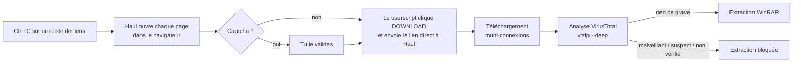

<div align="center">


# Haul

**Gestionnaire de téléchargements pour FuckingFast, sur Windows.**<br>
Copie les liens, Haul s'occupe du reste : téléchargement multi-connexions, analyse VirusTotal, extraction WinRAR.


</div>

---

## Fonctionnalités

- **Presse-papier surveillé** — sélectionne une liste de liens sur une page web et fais Ctrl+C :
  les URL sont lues dans la version HTML du presse-papier, même si le texte copié ne montre que
  les noms de fichiers.
- **Captcha respecté** — chaque page s'ouvre dans ton navigateur habituel, où tu valides le
  captcha si Cloudflare en demande un. Une validation vaut pour les liens suivants.
- **Téléchargement hors navigateur** — un userscript récupère le lien direct et l'envoie à Haul,
  qui télécharge en **plusieurs connexions par fichier**, plusieurs fichiers en parallèle,
  avec **reprise** après coupure.
- **Analyse VirusTotal avant extraction** — via [vtzip](docs/vtzip.md) (inclus) : hash des
  fichiers et des exécutables *à l'intérieur* des archives, sans rien extraire ni envoyer.
- **Extraction WinRAR automatique** — quand toute la liste est téléchargée et que l'analyse ne
  signale rien : *Extraire et mettre à jour*, *Remplacer sans demander*.

## Comment ça marche



Le userscript communique avec Haul par un petit serveur HTTP local (`127.0.0.1:17655`) qui
n'accepte que les requêtes de l'extension ou de fuckingfast.co, et uniquement des liens
directs `dl.fuckingfast.co`.

## Installation

### Prérequis

- Windows 10/11, [WinRAR](https://www.win-rar.com/) (pour l'extraction et le listage des RAR)
- Un navigateur avec [Violentmonkey](https://violentmonkey.github.io/) ou Tampermonkey
- Une clé API VirusTotal gratuite (profil > *API key* sur [virustotal.com](https://www.virustotal.com))
- Python 3.10+ pour lancer depuis les sources ou construire l'exécutable

### Depuis les sources

```powershell
git clone <url-du-depot> haul
cd haul
py -3.12 -m venv .venv
.venv\Scripts\python -m pip install -e ".[dev]"
.venv\Scripts\vtzip config set-key     # clé API VirusTotal, saisie masquée
.venv\Scripts\haul                     # lance l'application
```

### Exécutable autonome

```powershell
.\scripts\build.ps1                    # produit dist\Haul.exe (aucun Python requis pour l'utiliser)
```

### Première utilisation

1. Lance Haul, puis clique **Installer le script navigateur** : Violentmonkey propose
   d'installer le userscript.
2. Copie une liste de liens `fuckingfast.co` depuis une page web : les téléchargements démarrent.

## Utilisation

| Réglage | Effet |
| --- | --- |
| Surveiller le presse-papier | Ajoute automatiquement les liens copiés. |
| Fichiers simultanés | Nombre de fichiers téléchargés en même temps (2–3 conseillés). |
| Connexions par fichier | Découpage de chaque fichier (8 conseillé). |
| Analyser avec VirusTotal | Analyse le lot quand toute la liste est téléchargée. |
| Puis extraire avec WinRAR | Extrait les archives si l'analyse ne bloque pas. |

Boutons : **Réessayer les échecs** (reprend là où le fichier s'était arrêté, rouvre la page si le
lien a expiré), **Retirer les terminés**, **Analyser / extraire maintenant**, **Rapport VirusTotal**
(rapport détaillé de vtzip), **Installer le script navigateur**. Un bouton est grisé quand il n'a
rien à faire.

Dans la liste :

- une ligne sélectionnée affiche son statut complet dans la barre d'état, et un texte trop long
  pour sa colonne s'affiche en entier au survol ;
- clic droit : *Afficher dans l'Explorateur*, *Copier le lien de la page*, *Réessayer*,
  *Retirer de la liste* ; double-clic : afficher le fichier ; <kbd>Suppr</kbd> : retirer ;
- <kbd>Ctrl</kbd>+<kbd>V</kbd> dans la fenêtre ajoute les liens du presse-papier (utile quand la
  surveillance est désactivée).

L'apparence suit le mode clair ou sombre de Windows ; pour l'imposer, mets `"theme": "light"` ou
`"theme": "dark"` dans `config.json` (voir [Données](#données)).

### Politique d'extraction

| Verdict vtzip | Extraction |
| --- | --- |
| PROPRE, INCONNU DE VT, DÉTECTIONS GÉNÉRIQUES | ✅ lancée |
| MALVEILLANT, SUSPECT | ⛔ bloquée |
| Analyse impossible (quota, réseau, clé absente) | ⛔ bloquée |

Un repack recompressé est presque toujours *inconnu* de VirusTotal, et les détections
génériques sont le bruit attendu sur un crack : voir [docs/vtzip.md](docs/vtzip.md). Pour extraire
malgré un blocage, désactive *Analyser avec VirusTotal* puis clique *Analyser / extraire maintenant*.

## Données

| Emplacement | Contenu |
| --- | --- |
| `%APPDATA%\Haul\config.json` | Réglages de l'application (dont `theme` : `system`, `light` ou `dark`) |
| `%APPDATA%\Haul\haul.log` | Journal (liens reçus, erreurs, extractions) |
| `%APPDATA%\Haul\reports\` | Rapports VirusTotal au format JSON |
| `%APPDATA%\vtzip\` | Clé API et cache des résultats VirusTotal (24 h) |

## Structure du dépôt

```
├── src/
│   ├── haul/                  application
│   │   ├── __main__.py        point d'entrée (haul, python -m haul, Haul.exe)
│   │   ├── gui.py             fenêtre Tkinter
│   │   ├── theme.py           apparence : palette claire/sombre, styles ttk, formes dessinées
│   │   ├── widgets.py         disposition fluide, sélecteur numérique, infobulles
│   │   ├── engine.py          file de téléchargements, ouverture des pages
│   │   ├── downloader.py      téléchargement segmenté avec reprise (curl_cffi)
│   │   ├── server.py          serveur local pour le userscript
│   │   ├── postprocess.py     analyse VirusTotal + extraction WinRAR
│   │   ├── clipboard.py       lecture du presse-papier HTML (Win32)
│   │   ├── links.py           reconnaissance des liens
│   │   ├── config.py, paths.py
│   │   └── assets/            userscript, icône
│   └── vtzip/                 vérification VirusTotal (aussi utilisable en ligne de commande)
├── tests/                     pytest : haul/ et vtzip/
├── scripts/                   build.ps1 (exécutable), make_icon.py
└── docs/vtzip.md              documentation de vtzip
```

## Développement

```powershell
.venv\Scripts\pytest               # tests (les tests WinRAR sont ignorés si WinRAR est absent)
.venv\Scripts\ruff check src tests # lint
```

vtzip reste utilisable seul : `.venv\Scripts\vtzip --deep C:\chemin\du\dossier`.

## Licence

[MIT](LICENSE)
